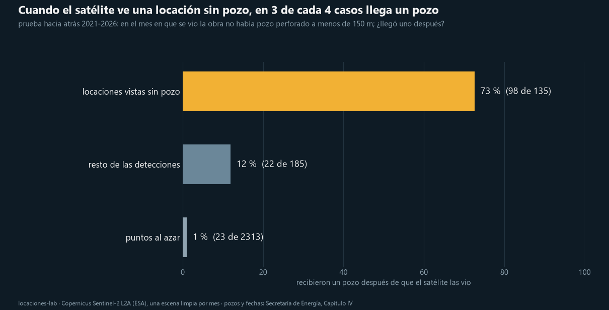
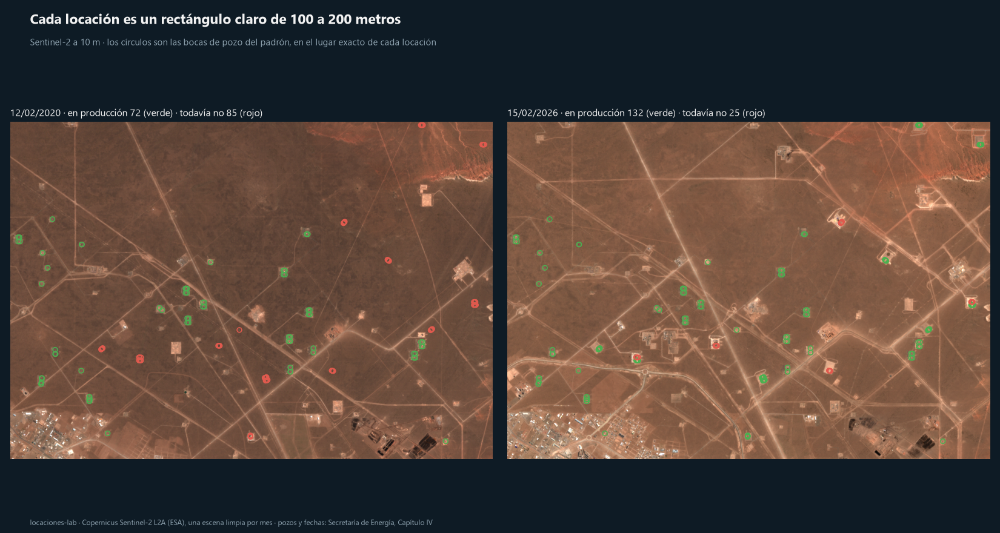
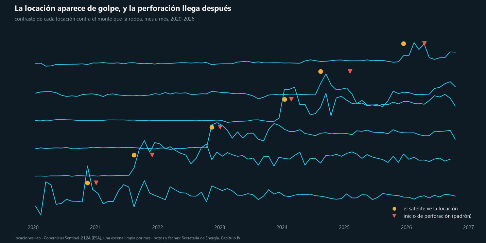
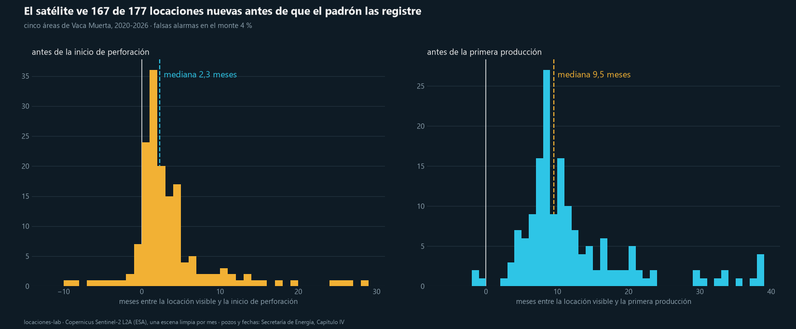
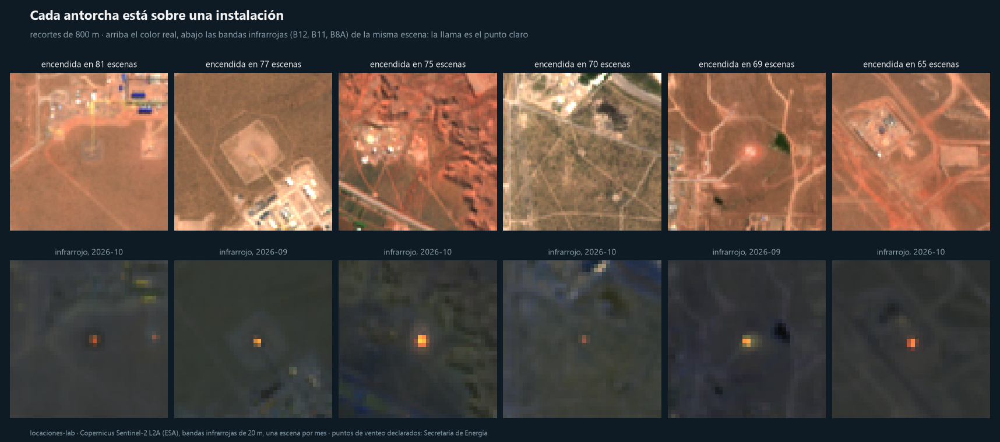
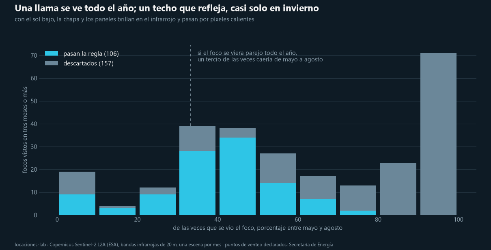
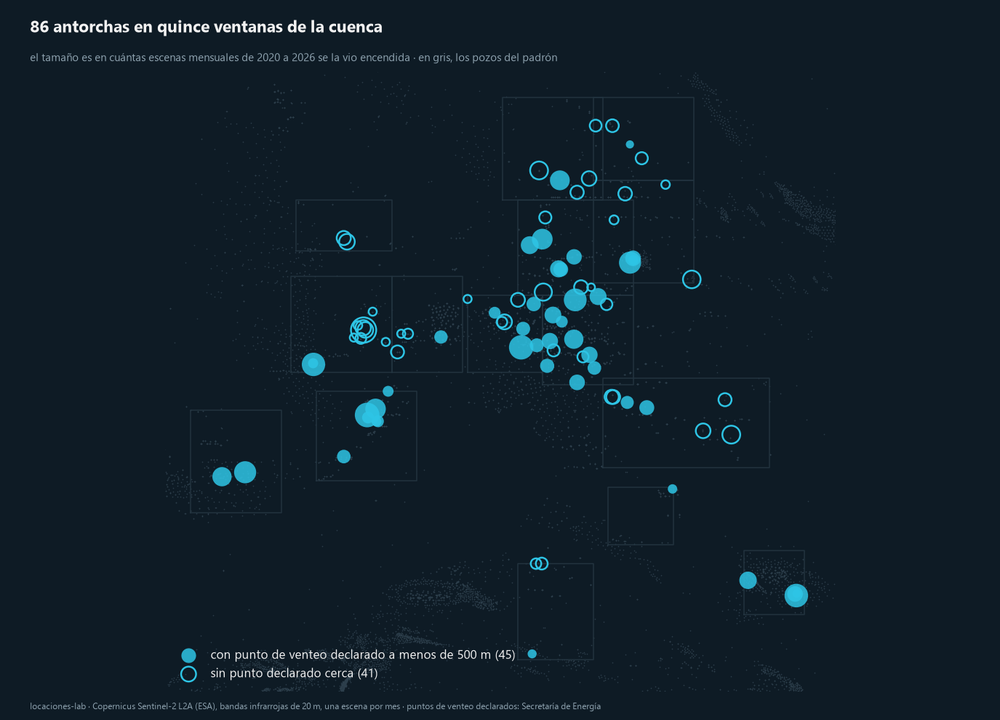

# locaciones-lab

¿Se puede ver la actividad de Vaca Muerta desde el satélite antes de que aparezca en el registro
oficial? Con una imagen gratis de Sentinel-2 por mes desde 2020 sobre cinco áreas de la cuenca
Neuquina y los pozos del Capítulo IV de la Secretaría de Energía. Duodécimo repo de la serie
Sur Analytics.

> Antes de perforar un pozo se desmonta una locación: un rectángulo de 100 a 200 metros en el monte.
> El satélite la ve casi un año antes de que el pozo registre su primer barril. Y cuando ve una
> locación nueva sin pozo al lado, en 3 de cada 4 casos llega un pozo, casi siempre en dos meses.



## De dónde sale

En la cuenca Pérmica de Estados Unidos hay empresas que venden la actividad petrolera vista desde el
satélite: detectan la locación en construcción meses antes del permiso de perforación. Este repo hace
la misma pregunta para Vaca Muerta con datos abiertos: imágenes de 10 metros de Copernicus y el padrón
público de pozos, y la responde con una prueba hacia atrás, no con un ejemplo.

## Qué hace

| Notebook | Qué hace |
|---|---|
| `01_la_locacion_se_ve` | Verifica que cada locación se ve en Sentinel-2 y que el pozo del padrón cae encima. Sigue el contraste de cada una de las locaciones de cinco áreas contra el monte que la rodea, en 82 escenas mensuales, y fecha su construcción. Mide cuánto antes aparece que el inicio de perforación y que la primera producción. |
| `02_el_detector_a_ciegas` | Busca locaciones sin mirar el padrón, en toda la serie, con el contraste local de cada píxel. Clasifica qué es locación y qué es camino, planta, pueblo o barda, con 48 detecciones etiquetadas a mano. Prueba hacia atrás: en el mes en que el satélite vio la obra, ¿había un pozo perforado al lado? Si no, ¿llegó uno después? Y verifica las locaciones del último año que todavía no tienen pozo registrado. |
| `03_las_antorchas` | Busca las antorchas en las bandas infrarrojas de la misma escena mensual, en quince ventanas. Muestra por qué un píxel caliente no alcanza (los techos de Añelo brillan en invierno), arma la regla, revisa una por una las dudosas y cruza el resultado con los puntos de venteo que las empresas declaran a la Secretaría de Energía. |

Las funciones están en `src/loclab/`: `escenas.py` busca y baja la serie mensual del STAC público
de Sentinel-2 y elige la escena limpia de cada mes; `padron.py` lee los pozos, sus fechas y las
locaciones multipozo; `senal.py` mide el contraste de una locación y fecha su construcción;
`ciego.py` es el detector a ciegas, la regla de clasificación y la prueba hacia atrás;
`antorchas.py` baja las bandas infrarrojas, marca los píxeles calientes, los agrupa en focos y aplica
la regla de antorcha; `figuras.py`, las figuras.

## Qué encontramos

**La locación se ve, y el pozo cae encima.** A 10 metros, cada locación es un rectángulo claro sobre
el monte oscuro. Las coordenadas del Capítulo IV son de boca de pozo y caen sobre la locación; en
Loma Campana, 710 de 770 pozos tienen otro a menos de 30 metros: son las locaciones multipozo.



**El satélite ve 167 de 177 locaciones nuevas, casi un año antes de la producción.** En las cinco áreas,
de 2020 a 2026, siguiendo el contraste de cada locación contra el monte vecino mes a mes:

| | Mediana |
|---|---|
| Locaciones nuevas detectadas | 167 de 177 (94 %), 725 pozos |
| Adelanto sobre el inicio de perforación | 2,3 meses (la ve antes en el 85 %) |
| Adelanto sobre la primera producción | 9,5 meses |
| Falsas alarmas en el monte | 2 a 9 % según la zona |

El satélite no adelanta mucho la perforación, porque el operador desmonta la locación poco antes de
traer el equipo. Lo que adelanta es la producción.





**A ciegas, y con la prueba hacia atrás.** Sin mirar el padrón, el detector encuentra 422 obras nuevas
en las cuatro ventanas; 186 se clasifican como locación con una regla de tamaño y fuerza del salto
(recall 81 %, precisión 94 % en 48 detecciones etiquetadas, dejando una afuera; la forma no separa: un
cruce de caminos es tan compacto como una locación). Después, para cada una, en el mes en que se vio:

| Lo que vio el satélite, sin pozo perforado al lado | Recibió un pozo después |
|---|---|
| Locaciones vistas hace al menos 12 meses | 73 % (98 de 135) |
| Resto de las detecciones (caminos, plantas, pueblo) | 12 % (22 de 185) |
| Puntos al azar en las mismas zonas | 1 % (23 de 2.313) |

La espera mediana entre la locación visible y el inicio de perforación es de 1,9 meses.

**Lo que el satélite ve y el padrón todavía no.** 28 locaciones vistas desde julio de 2025 no tienen
hoy ningún pozo registrado a menos de 150 metros. El padrón carga los pozos nuevos con unos seis
meses de demora: en las cuatro ventanas registra entre 20 y 48 pozos por trimestre de inicio de
perforación hasta el primero de 2026, y 8 en el segundo. Mirando cada una en la escena de septiembre y octubre
de 2026:

| Estado en octubre de 2026 | Locaciones |
|---|---|
| Con equipos trabajando | 12 |
| Locación construida, sin equipo todavía | 8 |
| Instalación o locación con actividad | 2 |
| Dudosa | 1 |
| Falsa (pueblo, valle, barda) | 5 |

Veintidós obras reales sin pozo en ningún registro público. La confirmación por el padrón llega a
comienzos de 2027. Las coordenadas no se publican.

**CBERS-4A no cubre Vaca Muerta.** El catálogo abierto del INPE no tiene ninguna escena CBERS-4A sobre
Neuquén entre 2019 y 2026. Para la cuenca, el satélite es Sentinel-2.

## Las antorchas

Una chimenea de quema encendida emite en el infrarrojo de onda corta. En Sentinel-2 es un píxel donde la
banda de 2,2 micrones (B12) queda muy por encima de la de 1,6 (B11) y del infrarrojo cercano (B8A): en
una escena de Loma Campana este, 0,83 contra 0,41 y 0,22, cuando el resto de la ventana da 0,18, 0,19 y
0,17. El índice es el de anomalía térmica de Liu et al. (2021), TAI = (B12 − B11) / B8A.



**No todo lo que brilla es una llama.** En 1.220 escenas mensuales de quince ventanas hay 4.420
detecciones y 263 focos que se repiten en tres meses o más. De esos, 101 están en la ventana de Añelo:
son techos de chapa y galpones, que con el sol bajo del invierno reflejan en el infrarrojo. Se delatan
por el calendario: una llama se ve todo el año, un reflejo casi solo de mayo a agosto.



| La regla, paso a paso | Focos |
|---|---:|
| Vistos en tres escenas mensuales o más | 263 |
| Y tres o más fuera del invierno (septiembre a abril) | 139 |
| Y que saturan la banda de 2,2 micrones alguna vez | 119 |
| Y a más de 3 km de Añelo | 106 |
| Sin repetir entre ventanas vecinas (a menos de 200 m es la misma) | 94 |
| Después de mirarlas una por una (`data/antorchas_revision.csv`) | **86** |

La revisión a mano sacó seis que eran galpones o bases de servicios junto a zonas urbanas y dos que no
se pudieron ver porque la escena estaba saturada.

**Crecen con la actividad.** Antorchas vistas encendidas al menos una vez en el año: 39 en 2020, 45, 55,
57, 59, 65 en 2025 y 63 en 2026 hasta octubre. En la última escena estaban encendidas 25 de las 86. La
mediana es de 21 escenas con llama sobre 82.

**Contra lo declarado.** La Secretaría de Energía publica 1.269 puntos de venteo declarados por las
empresas; 173 caen en las ventanas.

| | |
|---|---:|
| Antorchas vistas con un punto declarado a menos de 150 m | 42 de 86 |
| Con un punto declarado a menos de 500 m | 45 de 86 |
| Sin ningún punto declarado a menos de 500 m | 41 de 86 |
| Chimeneas de quema declaradas que se vieron encendidas | 67 de 101 |
| Fosas de quema declaradas que se vieron encendidas | 8 de 72 |



Que una antorcha no tenga un punto declarado cerca no la vuelve irregular. De las 41, nueve se vieron
menos de ocho meses, y varias están sobre locaciones de pozo: una quema temporal de ensayo no lleva un
punto fijo. Y ocho están en una sola ventana, lo que apunta a un registro incompleto en esa área. Otras
17 llevan veinte meses o más encendidas: son las que vale la pena mirar con más detalle.

## El tablero

<https://dpinero14.github.io/locaciones-lab/tablero/>

El detector corrido sobre quince ventanas de la cuenca (`scripts/detectar.py`), en un mapa: mes a mes,
cada locación aparece cuando el satélite la ve y el pozo del padrón cuando llega. Suma los gasoductos
troncales y las plantas compresoras de ENARGAS, la ruta de la arena de
[arena-lab](https://github.com/dpinero14/arena-lab), un mapa de calor de producción contra exploración y
dos pestañas:

- **Demanda:** pozos fracturados, etapas, arena, agua, camiones y equipos por año desde 2019, del
  Adjunto IV de fracturas, con la proyección de 2027 a partir de las locaciones que ya se ven.
- **Finanzas:** la producción nueva por operadora con la curva tipo de la cuenca, y la facturación y las
  regalías al precio que elija quien lo mira.

También muestra las antorchas, que se prenden y se apagan con la línea de tiempo, y los puntos de venteo
declarados; un filtro por operadora, una ficha por ventana, la comparación con la imagen de 2020 y un
recorrido guiado de un minuto.

Es la versión pública: las locaciones que todavía no tienen pozo registrado no se publican, entran solo
como conteo por ventana.

## Limitaciones

- **Cuatro ventanas, cinco áreas.** Loma Campana, La Amarga Chica, Bajada del Palo, Bandurria y Fortín
  de Piedra: el corazón de la actividad, no toda la cuenca.
- **Una escena por mes.** El satélite pasa cada 5 días; la serie mensual alcanza para fechar locaciones
  pero no para ver el equipo de perforación llegar y irse.
- **La ampliación de un pad viejo** también se enciende: es actividad real, pero no es una locación
  nueva. En el notebook 01, una de cada cinco locaciones viejas "se construye" en la serie.
- **La regla de clasificación** está ajustada con 48 etiquetas hechas por una persona. Es poco; una
  muestra mayor y etiquetada por otro la haría más confiable.
- **El padrón como verdad** tiene su propio atraso y sus errores. Un pozo a menos de 150 m de la
  detección cuenta como acierto aunque sea de otra locación vecina.
- **El cerca de Añelo** es difícil: el pueblo crece y confunde al detector; la regla lo excluye.
- **Las antorchas se ven con una escena por mes.** Una llama se prende y se apaga, y el satélite pasa
  cada dos o tres días: en un mes dado, la escena elegida pierde las que estuvieron encendidas otros días. No se mide cuánto gas se
  quema, solo dónde y cuándo hay llama. Las fosas de quema casi no se ven. Y la regla pierde algunas
  reales: descarta focos que sí tienen un punto declarado al lado.
- **La operadora de una antorcha no se publica.** Se podría atribuir por el pozo más cercano, pero la
  dueña de la instalación puede ser otra.

## Cómo correrlo

```
python -m venv .venv
.venv\Scripts\python.exe -m pip install -r requirements.txt
.venv\Scripts\python.exe -m ipykernel install --user --name locaciones-lab --display-name "locaciones-lab"
.venv\Scripts\python.exe scripts/download_data.py --series
.venv\Scripts\python.exe -m pytest -q tests
.venv\Scripts\python.exe -m jupyter nbconvert --to notebook --execute --inplace notebooks/01_la_locacion_se_ve.ipynb
.venv\Scripts\python.exe -m jupyter nbconvert --to notebook --execute --inplace notebooks/02_el_detector_a_ciegas.ipynb
.venv\Scripts\python.exe scripts/antorchas.py --bajar
.venv\Scripts\python.exe -m jupyter nbconvert --to notebook --execute --inplace notebooks/03_las_antorchas.ipynb
```

La serie de Sentinel-2 son unas 80 escenas por zona recortadas a la ventana, unos 3 GB y 40 minutos
por zona. En Linux, en lugar de `.venv\Scripts\python.exe`, `.venv/bin/python`.

## Datos y licencias

- Copernicus Sentinel-2 L2A (ESA), por el catálogo STAC público de Element84 en AWS:
  <https://earth-search.aws.element84.com/v1>. Datos libres y abiertos de Copernicus.
- Secretaría de Energía, Capítulo IV: shapefile de pozos y producción de pozos no convencionales,
  CC BY 4.0: <http://datos.energia.gob.ar/dataset/c846e79c-026c-4040-897f-1ad3543b407c>
- Secretaría de Energía, puntos de venteo declarados, CC BY 4.0:
  <http://datos.energia.gob.ar/dataset/produccion-hidrocarburos-puntos-de-venteo-declarados>
- Liu, Y. et al. (2021), *Automatic extraction of offshore platforms and gas flares using Sentinel-2
  thermal anomaly index*: de ahí sale el índice TAI.
- `data/antorchas_revision.csv`: los ocho focos que pasaron la regla y se descartaron mirándolos.
- `data/etiquetas_muestra.csv`: 48 detecciones etiquetadas a mano, sin coordenadas.
- `data/verificacion_visual_2026-10.csv`: la verificación visual de las 28 locaciones sin pozo, sin
  coordenadas.

Código con licencia MIT.

## Autor

Diego Piñero · Sur Analytics
